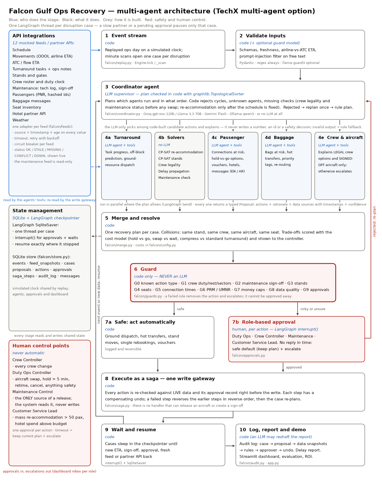

# Falcon Gulf Ops Recovery

A **multi-agent system** that keeps a hub airline on schedule during disruption: it watches live operational feeds,
predicts knock-on delay, compresses turnarounds, protects connections, re-accommodates passengers fairly, saves transfer
bags, and sends every crew, aircraft, schedule and safety decision to the right human controller.

Built on the TechX multi-agent option (`docs/reference/TechX_Agentic_Workflow_MultiAgent.pdf`) with LangGraph.
**All data is fictional** (airline, hub, flights, crew, passengers). All limits and costs are demo values in
[`falcon/config.py`](falcon/config.py).



## What it does

- **Replays one operations day** (fixed seed): 420 hub departures, 133 aircraft, about 67,000 passengers, 12 feeds and
  14 scripted disruptions (sandstorm, late inbounds, a cancellation, a crew duty limit, a tech fault, stale and
  conflicting feeds, a partner outage, an unanswered approval, a failed booking step, a prompt injection).
- **One LangGraph thread per disruption case.** A coordinator agent plans which specialists run; four LLM agents
  (turnaround, passenger, baggage, crew & aircraft) and five solvers (CP-SAT re-accommodation, CP-SAT stands, crew
  legality, delay propagation, maintenance check) work in parallel and each returns a typed proposal.
- **Agents propose, code decides, humans approve.** A code-only guard checks every action; safe ground and baggage
  actions run automatically; crew, aircraft and schedule changes wait for the right role; everything executes as a
  saga with undo and is written to an audit log.
- **Runs with no API key and offline.** Every LLM step has a rule-based fallback. With a Groq, Gemini or Ollama model
  the LLM plans and explains — it still never decides safety and never writes a number into an action.

## Results on the replayed day

Same seed, same events, same physical rules; manual baseline vs the system (`docs/EVALUATION.md`):

| Metric | Manual baseline | System |
|---|---:|---:|
| Knock-on (reactionary) delay | 536 min | 237 min |
| Total departure delay | 536 min | 299 min |
| Hub departures more than 15 min late | 11 | 2 |
| Misconnected bags | 320 | 160 |
| Average time to re-accommodate a passenger | 136 min | 11 min |
| Cancelled flight: all 310 passengers rebooked after | 154 min | 6 min |
| Missed connections | 271 | 248 |
| PRM / unaccompanied minors protected | 3 of 5 | 5 of 5 |
| Crew legality violations | 0 | 0 |

Missed connections improve least: most of them would need a hold longer than the 20-minute limit, so the system
rebooks those passengers quickly instead. The business case (`docs/BUSINESS_CASE.md`) prices these differences for
the airline and the ground handler with editable, clearly labelled demo assumptions.

## Run it (Windows, PowerShell)

First time only:

```powershell
python -m venv .venv
```

```powershell
.\.venv\Scripts\python.exe -m pip install -r requirements.txt
```

Start the dashboard (opens http://localhost:8501):

```powershell
.\.venv\Scripts\python.exe -m streamlit run app.py
```

Check everything end to end:

```powershell
.\.venv\Scripts\python.exe -m pytest
```

```powershell
.\.venv\Scripts\python.exe scenarios.py
```

```powershell
.\.venv\Scripts\python.exe -m falcon.evaluation
```

Optional LLM: put **one** key in `.env` (see `.env.example`; create the file with `Set-Content -Encoding ascii`).
`FALCON_LLM=off` forces the rule-based mode. The key is never printed, logged or committed.

## 5-minute demo script

Start the app. The sidebar holds the replay controls; nothing happens until you advance the clock.

| Time | Do this | Say this |
|---|---|---|
| 0:00 | Show the sidebar clock (13:45) and the tabs. | "A replayed operations day, 420 departures, all fictional. Same seed, same day, every time." |
| 0:20 | Click **Next event** twice (S1 sandstorm 14:05, S2 late inbound 14:10). Look at **Ops overview**. | "The sandstorm opened about 30 cases, each in its own thread. Ground and baggage actions already ran automatically. One request is waiting for a human." |
| 0:50 | **Approvals → Duty Ops Controller.** Open *Details*, then **Approve** the aircraft swap. | "The system proposes, with the data it used and its age, and the guard result. It cannot swap an aircraft itself. I approve — it executes, and the late flight leaves the chart." |
| 1:30 | **Next event** (S3, 14:20). **Cases → C-FG531.** | "Hold-vs-go: hold FG532 12 minutes for 38 connecting passengers, or go on time. Both costs are shown. This is the coordinator's plan, checked in code, and what each agent proposed." Approve the hold (or reject it to show the re-plan). |
| 2:20 | **Next event** (S4, 14:35). **Approvals → Customer Service Lead**, approve both requests. **Cases → C-FG718.** | "A cancelled flight, 310 passengers. The CP-SAT solver applies the published priority table: reduced-mobility passengers and the unaccompanied minor first, groups never split. Above 50 passengers a human approves — then 193 groups are rebooked in seconds, bags follow, messages go out in English and Arabic." |
| 3:10 | Turn on **Simulated approvers answer for me**, click **Next event** three times (S5 crew, S6 tech fault, S7 stands). Open **Approvals → Maintenance Control**. | "The captain would exceed the duty limit: only legal standby crew are ever offered, and the Crew Controller approves. The only wide-body spare has no maintenance sign-off: the swap is not offered at all, it is escalated. Only Maintenance Control can record a release — the system reads it, never writes it." |
| 3:50 | Click **Next event** until S10 (15:45). Open **Feeds**. | "A stale movement record and an airline-vs-ATC conflict are flagged, not hidden. Actions that depend on them are held and resume by themselves when the data is reliable." |
| 4:15 | Click **Next event** until S13 (16:40). **Audit** → case **C-FG835**. | "The hotel API was down for 40 minutes: only that booking waited. Here a seat was sold while a family of three was being rebooked: step 3 failed, steps 2 and 1 were undone, and the case re-planned. Every action links to its data, rules, approver and undo." |
| 4:40 | **Evaluation**, then **Business case**; change one assumption. | "Same day, manual baseline vs system. And the ROI model: every figure is a quantity from the evaluation times an assumption you can edit." |

Shortcut: **Run until a human is needed** advances the clock to the next approval. **Auto-play** runs by itself and
pauses when an approval is waiting.

## Safety rules — where they are enforced and what tries to break them

| Rule | Enforced in code | Tests that try to break it |
|---|---|---|
| Never assign crew beyond duty, rest or sector limits | `solvers/crew_legality.py` returns legal options only; guard **G1** at plan time and again at write time; the replayed day itself refuses to depart an illegal crew | `test_guards::test_g1_*`, `test_agents::test_crew_agent_offers_only_legal_standby…`, scenario S5 |
| Never release or use an aircraft without a current maintenance sign-off | No action type and no write handler can create a sign-off; guard **G2**; `OpsDay.swap_aircraft` refuses; `record_signoff` accepts humans only | `test_guards::test_g2_*`, `test_saga::test_approved_swap_onto_an_unsigned_aircraft…`, `test_saga::test_nothing_in_the_gateway_can_release…`, scenario S6 |
| No crew, aircraft or network schedule change without the right human approval | Guard **G9** inside the write gateway requires an APPROVED record from the right role; per-action approvals; timeout → safe default + escalation | `test_guards::test_g9_*`, `test_saga::test_gateway_requires_the_approval_record…`, scenarios S3, S12 |
| LLMs only plan and explain | Agents choose among code-built candidates by id; unknown ids, unknown flight/crew/aircraft ids or instruction-like text are rejected → rule fallback; coordinator plan checked with `graphlib` | `test_agents` (LLM-output tests), `test_coordinator`, `test_workflow::test_a_misbehaving_llm…` |
| Stale, missing or conflicting data is shown and never guessed around | Every value carries source, time and age; airline-vs-ATC cross-check uses the later ETA; guard **G8** holds dependent actions; the case sleeps and resumes | `test_feeds`, `test_guards::test_g8_*`, scenarios S9, S10 |
| A partner outage affects only the cases that need it | Timeout, retry with backoff and a circuit breaker per adapter; one thread per case | `test_feeds::test_outage_retries…`, `test_saga::test_partner_outage…`, scenario S11 |
| Fair, rule-based re-accommodation | CP-SAT solved class by class in the published order; hard rules for PRM, unaccompanied minors, seats, groups (**G4–G6**) | `test_solvers` (priority, group, PRM/UMNR tests), scenario S4 |
| Privacy: no names or booking references in prompts or logs | Feeds expose hashed ids only; a prompt check blocks any booking reference | `test_replay::test_pax_feed_never_exposes…`, `test_agents::test_no_booking_reference…`, scenario SAFETY |
| Prompt injection in free text | Scanned in the feed adapter before the text is stored, shown or sent to an agent | `test_feeds` (injection tests), `test_agents::test_injected_ops_note…`, scenario S14 |
| Complete audit trail | `audit.trace()` links action → case → proposal → data snapshots → rules → approver → undo | `test_workflow::test_audit_trace_links…`, scenario SAFETY |

Current status: **130 unit and integration tests pass**; **14 of 14 scenarios plus the safety sweep pass**
(`outputs/test_log.md`).

## How the pieces fit

| Stage | Where | What |
|---|---|---|
| 1 Event stream | `falcon/replay.py`, `Engine.tick` | Replayed day on a simulated clock; a scan every minute opens one case per disruption |
| 2 Validate inputs | `falcon/feeds/` | Schemas, freshness, cross-feed check, injection filter |
| 3 Coordinator | `falcon/coordinator.py` | LLM plan → `graphlib` check → replan once → rule plan |
| 4 Agents and solvers | `falcon/agents/`, `falcon/solvers/` | Parallel workers, each returns a typed `Proposal` |
| 5 Merge | `falcon/merge.py` | One plan, collisions, trade-off scoring |
| 6 Guard | `falcon/guards.py` | Rules G0–G9 in plain code |
| 7 Approvals | `falcon/approvals.py` | Role inboxes, deadlines, safe default, escalation |
| 8 Execute | `falcon/saga.py` | One write gateway, live re-check, undo |
| 9 Wait and resume | `falcon/workflow.py` | `interrupt()` + SQLite checkpointer |
| 10 Log and report | `falcon/audit.py`, `app.py` | Audit log, delay report, dashboard |

Also: `falcon/baseline.py` (manual-operations policy), `falcon/evaluation.py`, `falcon/business_case.py`,
`data/generate_day.py` (the seeded day), `scenarios.py`, `docs/make_diagram.py`.
Support modules added to the planned layout: `falcon/models.py` (typed contracts) and `falcon/store.py` (SQLite tables).

## Deliverables

- Working end-to-end system on a replayed operations day: `app.py`, `scenarios.py`
- Architecture diagram: `docs/architecture.png`, `docs/architecture.pdf` (design detail in `docs/ARCHITECTURE.md`)
- Evaluation report: `docs/EVALUATION.md`
- Business-case model: `docs/BUSINESS_CASE.md` and the Business case tab

## Limits to be honest about

One seeded, simulated day. Estimates in the replay are exact, real ETAs are noisier. Ground teams and transfer
vehicles are simple half-hour pools. Passengers stranded at outstations are out of scope. Approver response times in
the evaluation are simulated. Cost figures are placeholders. The result shows that the design works end to end and
where its value comes from; it is not a forecast for a real airline.
