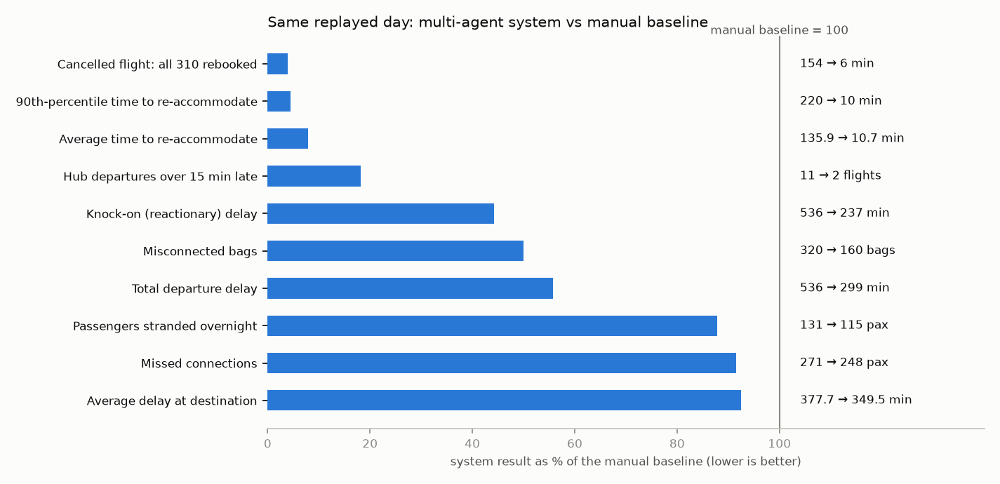

# Evaluation report — Falcon Gulf Ops Recovery

*Generated by `python -m falcon.evaluation`. All data is fictional; all thresholds and costs are demo values.*

## What was compared

The **same replayed operations day** (seed `20261117`: 420 hub departures, about 67,000 passengers, the 14 scripted disruptions S1–S14 plus everything the sandstorm causes) was run twice, with the same physical rules (a flight cannot leave with an illegal crew or an unsigned aircraft in either run):

- **Baseline — manual operations.** No proactive holds, no turnaround compression, no hot transfers. Every decision takes 25 min after the problem is noticed; crew problems are noticed at report time. Passengers are rebooked first-come-first-served by 12 agents at 12 passengers per agent-hour. It is a competent manual operation: it makes the same aircraft swaps as the system (6 of them), just later.
- **System — the multi-agent workflow.** Rule-based fallbacks (no LLM), so the result is reproducible. Human approvals are answered by simulated approvers after 4 min (Duty Ops Controller), 5 min (Crew Controller), 8 min (Maintenance Control), 6 min (Customer Service Lead); one scripted request is never answered (S12).

## Results

| Metric | Unit | Manual baseline | System | Change |
|---|---|---:|---:|---|
| Total departure delay (all legs) | min | 536 | 299 | -44% (better) |
| Reactionary (knock-on) delay | min | 536 | 237 | -56% (better) |
| Hub departures more than 15 min late | flights | 11 | 2 | -82% (better) |
| Hub on-time performance (within 15 min) | % | 97.4 | 99.5 | +2% (better) |
| Missed passenger connections | pax | 271 | 248 | -8% (better) |
| Passengers stranded overnight | pax | 131 | 115 | -12% (better) |
| Misconnected bags | bags | 320 | 160 | -50% (better) |
| Average time to re-accommodate a disrupted passenger | min | 135.9 | 10.7 | -92% (better) |
| 90th-percentile time to re-accommodate | min | 220 | 10 | -95% (better) |
| Cancelled flight: time until all 310 passengers have a new flight | min | 154 | 6 | -96% (better) |
| Average delay at destination of disrupted passengers | min | 377.7 | 349.5 | -7% (better) |
| PRM / unaccompanied minors rebooked within 30 min, same day, rule-compliant | groups | 3 | 5 | +67% (better) |
| Crew legality violations (must be 0) | count | 0 | 0 | same |



## How the system got there

- **82 disruption cases**, each in its own LangGraph thread (1 CANCELLATION, 55 LATE_INBOUND, 26 STAND_CONFLICT).
- **1066 actions executed**: 666 automatically (ground, baggage, individual rebooking inside every rule) and 400 under a human approval record.
- **12 approval requests**, average wait 4.5 min (Crew Controller: 5.0 min, Customer Service Lead: 6.0 min, Duty Ops Controller: 4.0 min, Ops Duty Manager (escalation): 6.0 min); 1 timed out and took the safe default before being escalated.
- **Trade-offs taken:** 19 holds totalling 62 min protected 90 connecting passengers; 6 aircraft swaps; 71 extra ground-team dispatches (AED 19,050); 43 hot transfers moved 341 bags.
- **Data quality:** 14 actions were held because an input was stale, conflicting or unavailable, and resumed when it was reliable again. 8 escalations went to humans.
- **Recovery:** 2 saga steps were undone after a failed step, then re-planned on fresh data.

## Safety outcome

- Crew legality violations: **0** (baseline 0).
- Actions blocked by a hard guard rule in the live run: 0 — the agents only ever proposed legal crew and signed-off aircraft; the guards are proven by tests that try to break each rule (`tests/test_guards.py`, `tests/test_saga.py`) and by `scenarios.py`.
- No crew, aircraft or schedule change executed without the right human approval record (checked in `outputs/test_log.md`, row SAFETY).

## What this does and does not show

- **Biggest gains:** knock-on delay (turnaround compression and earlier swaps), time to re-accommodate (solver in minutes vs a transfer-desk queue), bags (hot transfers) and priority passengers (the fairness table).
- **Smallest gain:** missed connections (271 → 248). Most misconnections on this day need a hold longer than the 20-minute limit or cost more than they save, so the system rebooks those passengers quickly instead of holding aircraft for them.
- **Assumptions that drive the numbers:** the approver response times above, the manual decision time and desk rate, and the cost model in `falcon/config.py`. Change them and re-run to see the sensitivity.
- **Limits of the model:** one seeded day; estimates in the replay are exact (real ETAs are noisier); ground teams and transfer vehicles are simple half-hour pools; outstation passengers are out of scope. The result is evidence that the design works end to end, not a forecast for a real airline.

## Reproduce

```powershell
.\.venv\Scripts\python.exe -m falcon.evaluation
.\.venv\Scripts\python.exe scenarios.py
```

Run time: baseline 3.3 s, system 10.9 s.
